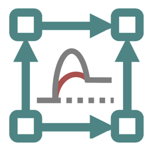

#  CatReNet App

CatReNet App analyzes (auto-)catalytic reaction networks. Input is a catalytic reaction system: a list of
catalyzed reactions and a food set of molecules. The app computes maximal RAFs (reflexively autocatalytic and
food-generated systems), CAFs and pseudo-RAFs, and several related constructs, with fast exact algorithms. It
visualizes the reaction network and can animate the emergence of an autocatalytic subsystem.

**Paper:** Daniel H. Huson, Joana C. Xavier and Mike A. Steel. CatReNet: interactive analysis of (auto-)
catalytic reaction networks. *Bioinformatics* 40(8), btae515 (2024).
[doi:10.1093/bioinformatics/btae515](https://doi.org/10.1093/bioinformatics/btae515)

**Desktop program:** [github.com/husonlab/catrenet](https://github.com/husonlab/catrenet) (GPL 3).

**App Store:** coming soon.

## Working with files

Documents are kept in the app's own folder on the device. The files tab of the app lists them, and the same
folder is visible in the Files app under *On My iPhone* (or *On My iPad*), where files can be copied, renamed or
moved to iCloud Drive. To bring a file into the app, share it from another app, from Mail or from Files and
choose the app, or copy its text and use *Import > Paste into new file* in the files tab. To get data out, use
*Export* in the files tab or the export items in the document itself: they open the system share sheet, from
which files and images can be saved, sent or copied.

## Support

Questions and bug reports: see the [support page](support). Privacy: the app does not collect any data, see the
[privacy policy](privacy). The third-party software included in the app and its licenses are listed on the
[licenses page](licenses) and in the app's About pane in the files tab.

[Back to all apps](./)
